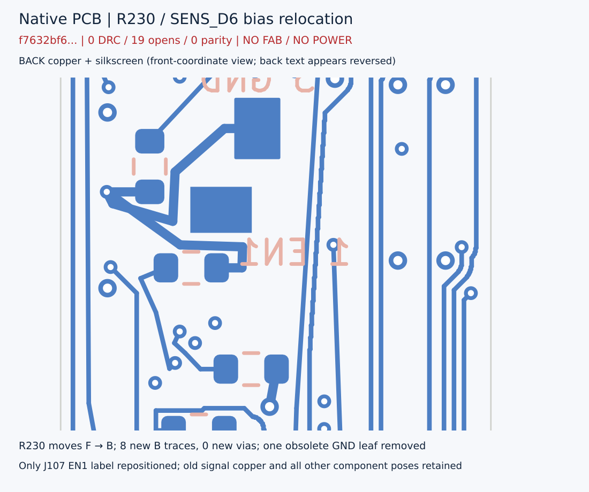

# 当前19项未连接主板 — 条件性静态WIP

**NOFAB / NO POWER。0错误、0警告、19项未连接、0原理图一致性问题，并不表示完整PCB或整笔完成。**

打开 `candidate/mainboard_revD.kicad_pro` 和顶层 `candidate/mainboard_revD.kicad_sch`，完整入口是103元件/10页；nested schematic目录内同名root是历史局部入口。54个原生工程文件，PCB SHA256 `f7632bf6296ba212ec59e54edb1dfdb91995f6f4f071a3d9505b6638f3fbf416`。

[累计23→19变更](../../verification/mainboard19_20261102/CHANGE_SUMMARY.md)明确记录R108移动、CAM_XCLK局部前缀、CAM_BUS走线及PICKUP_INT_N/AON_I2C_SDA西走廊改线、D7支路、R230翻面与J107单条文字位置修正。不是只新增四根线，也没有改GPIO、活动固件/provider或电池BOM。

[精简可复跑验证](../../verification/mainboard19_20261102/README.md)仅独立重放最后1639→f763步骤及当前库存；此前三步保留精确来源合同/有限拓扑结果/独立审查索引，不假称在此重跑全历史。当前19项拓扑未连接分布于14个有名网络，不是19个独立网络。

JP202默认OPEN/DNP，pad1连通不等于启用。J105附近0.0382mm只是历史预算的静态名义间隙，非工艺/装配裕量。R108/R230的1.45mm高度是历史保守预算，不是厂家高度。已知104安装实体/214形体模型不含camera/lens/FPC，不能声称整笔fit。电池未定，尾部冲突及探针/工具/焊接/线束/电源服务空间仍未闭合。
