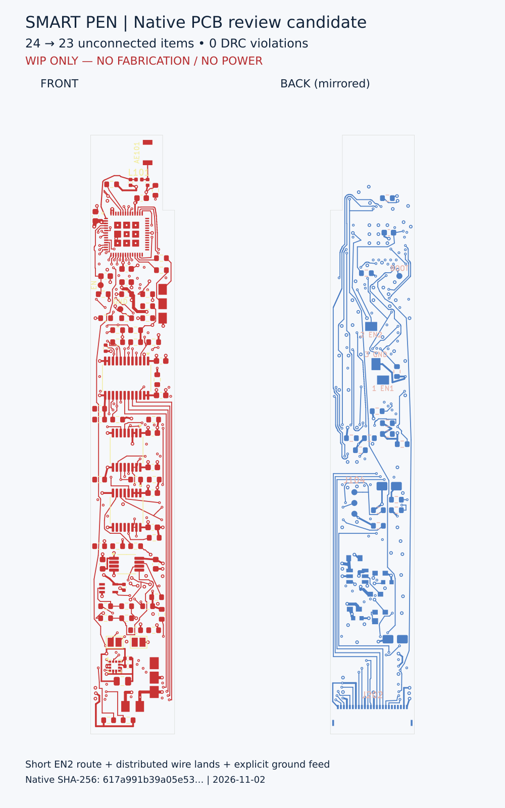

# 当前主板工作基线：2026-11-02

**WIP / NOFAB / NO POWER；23处未连接，不能直接制作或上电。**

打开 `candidate/mainboard_revD.kicad_pro`。54个原生工程文件按复核字节保存，PCB SHA256为 `617a991b39a05e53f6bbf55700d2aa84052a3b5140b947c2b66a503f9846d8b5`。实际KiCad9.0.2为0违规/23未连接/0网表差异。

[可复跑的原生与有限铜检查](../../verification/interface_codesign_20261102/README.md)；[当前104安装实体/214形体默认堆叠研究](../../mechanical/mainboard_binding_20261102/README.md)。旧目录是历史，不能混用规则、库、BOM或模型。

J107改为三个分布式定制焊线焊盘，不是现成连接器。USB_EN2已从U101.27连接至J107.2；USB_EN1仍未连接。ILLUM_STROBE改走背面，保留端点连接，未改变MCU引脚分配。新焊盘库与原理图封装关联同步更新。

EN2与GND两处拥有明确端子/网络/层/方向/宽度/位置约束的各端子限定区域内的表面铜引出规则；这不是整个焊点空间豁免，也不证明焊料、绝缘、工艺或线束可安装。最近新端子预算与电源C6名义间隙约0.1634mm，不是公差认证。新走线最小名义铜间隙约0.150267mm，相对0.15mm规则仅约0.267µm余量；零DRC不代表具备可制造裕量。

仍保留参考平面过孔附近缺口、TP301探针访问未知、整笔电池/尾部冲突及其他操作未知项。JP201/JP202/JP301保持OPEN，电源板JP1保持OPEN；OPEN不等于所有供电已安全隔离。
